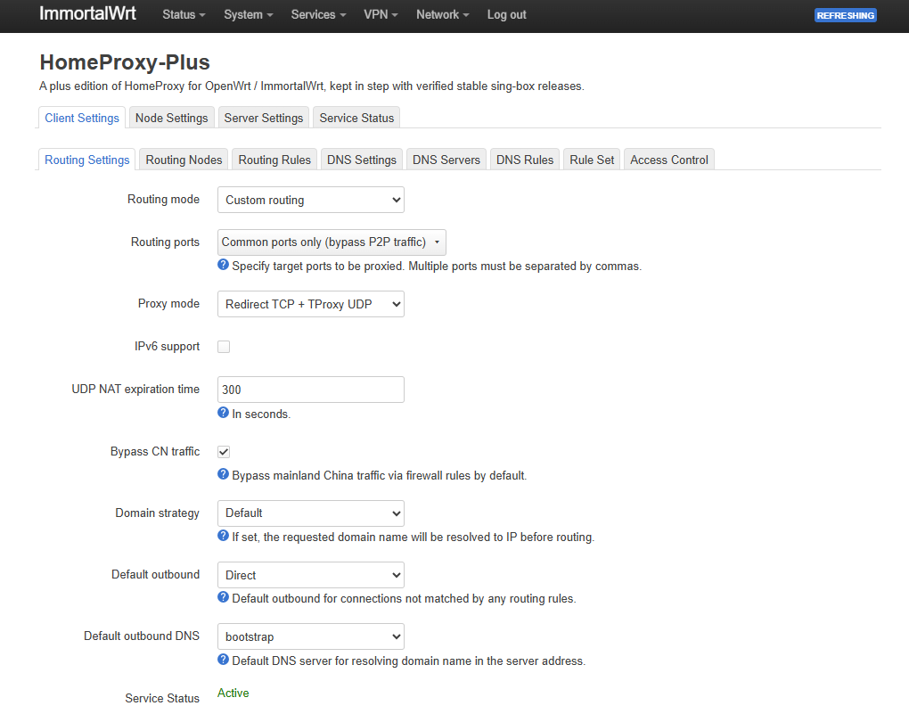
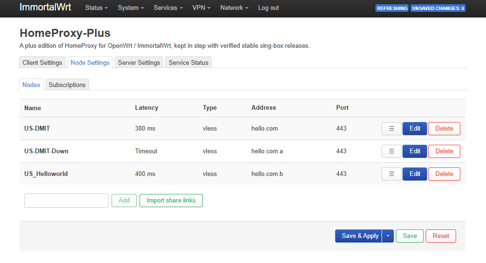
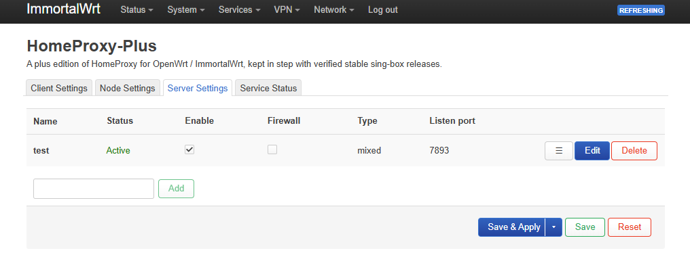

<!-- Copyright (C) 2026 Cerostep -->

# HomeProxy-Plus

HomeProxy-Plus is an independent LuCI package based on the
[ImmortalWrt HomeProxy](https://github.com/immortalwrt/homeproxy) source. It
targets OpenWrt and ImmortalWrt and bundles the verified OpenWrt `sing-box`
binary from the upstream GitHub release.

The package has its own UCI configuration (`homeproxy_plus`), init service,
LuCI/RPC identifiers, runtime directory, DNSMasq include, and firewall
identifiers. It does not replace or import an existing HomeProxy installation.
Package installation and upgrades migrate only the HomeProxy-Plus UCI
configuration.

## Quick start

### Requirements

- OpenWrt or ImmortalWrt 24.10 or later.
- One of the supported package architectures: `aarch64_generic`,
  `i386_pentium4`, or `x86_64`.
- LuCI access with administrator privileges.

HomeProxy-Plus bundles its verified `sing-box` binary. Do not install a
separate sing-box package for this application. Other runtime dependencies
are declared by the package and must be available from the device's configured
package feeds.

### Install a release

1. Open the [HomeProxy-Plus Releases](https://github.com/Cerostep/homeproxy-plus/releases)
   page and download the latest release asset that matches both your device's
   package architecture and package manager. Use the `.ipk` asset on
   `opkg`-based systems or the `.apk` asset on `apk`-based systems.
2. In LuCI, open **System > Software** and use its local package upload/install
   function to install the downloaded package. If installing over SSH, use
   your system's package manager and its local-file install command.
3. If installation reports missing dependencies, update the device's package
   lists and install from the configured OpenWrt/ImmortalWrt feeds. Do not
   replace the bundled sing-box binary.
4. Open **Services > HomeProxy-Plus**. The package can coexist with the
   original HomeProxy; keep the two applications' settings separate.

#### Install from the signed opkg feed

On `opkg`-based systems, you can install and update HomeProxy-Plus directly
from its signed package feed. First add the trusted public key, then configure
the feed and install the package:

```sh
curl -fsSLo /tmp/homeproxy-plus-feed.pub \
  https://raw.githubusercontent.com/Cerostep/homeproxy-plus/master/.github/homeproxy-plus-feed.pub
test "$(usign -F -p /tmp/homeproxy-plus-feed.pub)" = 'a776627ae8fe95d2'
opkg-key add /tmp/homeproxy-plus-feed.pub
grep -q '^src/gz homeproxy_plus ' /etc/opkg/customfeeds.conf ||
  echo 'src/gz homeproxy_plus https://github.com/Cerostep/homeproxy-plus/releases/latest/download' >> /etc/opkg/customfeeds.conf
opkg update
opkg install luci-app-homeproxy-plus
```

The feed is signed with `usign`; do not disable package signature verification.
It is available after a release publishes the signed feed index. See
[IPK software feed](./doc/package-feed.md) for details.

If direct access to GitHub is restricted, use the GH-Proxy URLs instead:

```sh
curl -fsSLo /tmp/homeproxy-plus-feed.pub \
  https://gh-proxy.org/https://github.com/Cerostep/homeproxy-plus/releases/latest/download/homeproxy-plus-feed.pub
test "$(usign -F -p /tmp/homeproxy-plus-feed.pub)" = 'a776627ae8fe95d2'
opkg-key add /tmp/homeproxy-plus-feed.pub
grep -q '^src/gz homeproxy_plus ' /etc/opkg/customfeeds.conf ||
  echo 'src/gz homeproxy_plus https://gh-proxy.org/https://github.com/Cerostep/homeproxy-plus/releases/latest/download' >> /etc/opkg/customfeeds.conf
opkg update
opkg install luci-app-homeproxy-plus
```

The proxy changes only the download route. The feed signature is still checked
against the pinned public-key fingerprint.

### Configure the client

1. In **Node Settings**, either add a node manually, import supported share
   links, or open **Subscriptions** and add one or more subscription URLs.
2. If you added subscriptions, save the subscription settings, then click
   **Update nodes from subscriptions**.
3. Open **Client Settings > Routing Settings** and select a node in **Main
   node**. The default routing mode is **Bypass mainland China**; choose a
   different mode if it better matches your network policy.
   If you select **Custom routing**, configure **Default outbound** in the
   custom routing settings instead.
4. Click **Save & Apply**. The client starts when a main node is selected.
   The initial configuration uses ports `5430`-`5433` and the TUN device name
   `singtunp0`; do not assign conflicting resources to another service.
5. On **Client Settings**, check **Service Status**. Then verify connectivity
   from a LAN device. The separate **Service Status** page's connection checks
   test the router's own connectivity and are not a substitute for testing
   client traffic through the proxy.

To run a server instead, add and enable a server entry in **Server Settings**,
configure its listen port and credentials, then save and apply. Ensure the
port is permitted by your firewall and reachable from the intended clients.

### Troubleshooting

- If the client does not start, confirm that a **Main node** is selected and
  check **Client Settings > Service Status** and the HomeProxy-Plus service
  log at `/var/run/homeproxy_plus/homeproxy_plus.log`.
- Check the sing-box client log at `/var/run/homeproxy_plus/sing-box-c.log`
  for configuration or connection errors. Do not post logs containing
  subscription URLs, credentials, private keys, or other secrets.
- For support, include the OpenWrt/ImmortalWrt version, package version,
  device architecture, and relevant redacted error messages.

## Interface overview

### Routing Settings

Configure routing, proxy mode, DNS, and access control using the client tabs.
Available options depend on the selected routing mode.



### Node Settings

Add nodes, import share links, or manage subscriptions. The **Latency** column
periodically shows TCP connection time to each node, or `Timeout`, `Failed`,
or `N/A`. It does not measure proxy traffic or verify the proxy protocol.



### Server Settings

Manage servers and view their status. **Active** means a matching local
listener was found; **Stopped** means it was not found or the server is
disabled. **Probe unavailable** indicates that the status could not be checked.
This does not confirm external reachability or authentication.



## Build

Build standalone packages with the tools used by the GitHub workflow (`curl`,
`po2lmo`, and `ipkg-build` for IPK or `apk` for APK):

```sh
bash .github/build-ipk.sh ipk snapshot x86_64
bash .github/build-ipk.sh apk snapshot x86_64
```

Replace `x86_64` with the target package architecture. Output files are placed
in `.github/`.

The GitHub workflow builds architecture-specific IPK and APK artifacts for
`aarch64_generic` (arm64 generic), `i386_pentium4` (32-bit x86), and `x86_64`.
It downloads the pinned
sing-box 1.14.4 OpenWrt package during the build, verifies its SHA-256 against
the upstream GitHub release digest, and bundles its binary. No sing-box
download is performed on the device. Other runtime dependencies are resolved
by the target OpenWrt/ImmortalWrt feed, including `curl` for the LuCI
connection checks.

For an Alpha pre-release, create and publish a tag matching
`v<PKG_VERSION>-alpha.<N>` (for example, `v0.1.0-alpha.1`) as a GitHub
pre-release. The release workflow uses the tag to version both package
formats, with package-manager-specific pre-release ordering. The tag's base
version must match `PKG_BASE_VERSION` in `.github/build-ipk.sh`.

See [arch.md](./arch.md) for the binding implementation constraints, AI coding
tool instructions, and validation requirements.

## License and upstream

The code is licensed under GPL-2.0-only. Copyright notices from the upstream
project are retained in the files derived from it.
